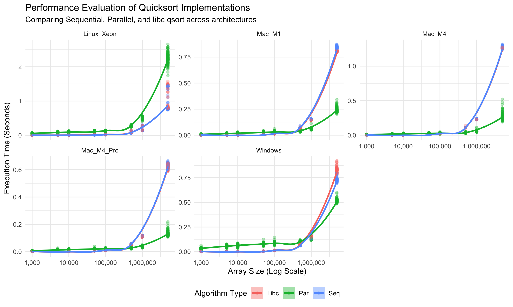
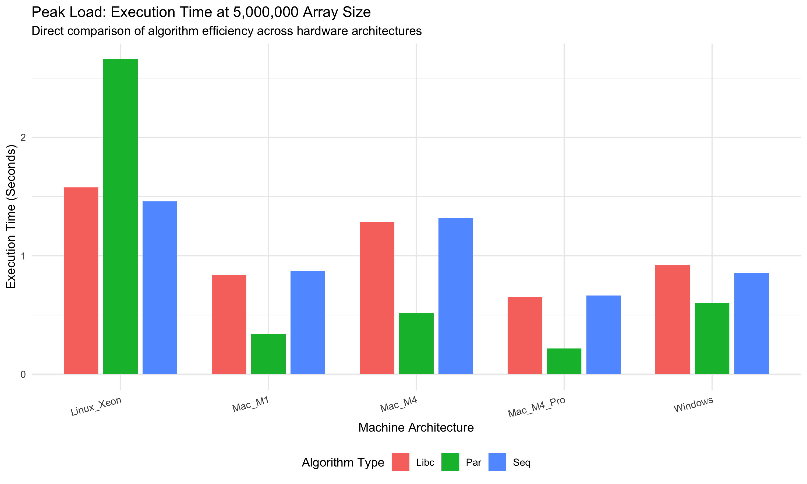

# Final Performance Evaluation: Multi-Threaded Quicksort

### 1. Experimental Design and Statistical Rigor
The original benchmarking protocol was deeply flawed. Relying on just five repetitions per size leaves too much room for system noise and background processes to corrupt the data. We upgraded the experimental design by executing tiered repetition benchmarks (25, 50, and 100 iterations) for varying array sizes ranging from 1,000 up to a peak load of 5,000,000 elements. We also randomized the execution order to eliminate CPU thermal throttling biases

This sheer volume of data points allowed us to calculate strict 95 percent confidence intervals. In our primary visualization, the narrow shading around the continuous trend lines proves the variance across these 100 runs is minimal. The performance differences we mapped are statistically significant, not just isolated spikes.

### 2. Threshold Analysis and the 400,000 Claim
The initial hypothesis claimed the parallel implementation would save significant time by crossing over the sequential baseline around the 400,000 element mark. The actual data shows this threshold is entirely dictated by the hardware architecture. 

On consumer-grade laptops with unified memory (Mac M1, M4, and M4 Pro), the parallel algorithm clearly overtakes both the sequential and libc implementations well before 500,000 elements. The Windows machine validates this trend as well, though the crossover happens slightly later. However, on the Linux Xeon server, the parallel code never achieves a crossover. It consistently lags behind the single-threaded baselines at every single size.

### 3. Continuous Trends and Extrapolation
By mapping the execution time against the array size on a logarithmic scale, we can accurately predict performance beyond our 5,000,000 element ceiling. On the consumer machines, the continuous trend line for the parallel algorithm flattens out favorably. If we extrapolate this trajectory to 20,000,000 elements, the parallel version would scale efficiently and compound the time savings. 

The Xeon server presents a completely different reality. Its continuous trend line curves upward aggressively. Extrapolating the server data suggests catastrophic slowdowns for the parallel code at larger scales.

### 4. Hardware Architecture and The Server Penalty
The most critical finding of this project is the massive performance failure on the Linux Xeon machine, which is definitively visualized in the graphic below. At the 5,000,000 peak load, the green parallel bar dwarfs the sequential and libc bars on the Linux server, while it remains the shortest bar on every other machine. 

It is a common misconception that a server's powerful specifications or GPU will automatically accelerate all workloads. This specific quicksort implementation runs entirely on the CPU. The server's poor performance comes down to thread management overhead. Enterprise server chips like the Xeon often feature multiple physical processors spread across complex memory zones. The operating system expends far more time and energy creating, synchronizing, and destroying threads across these zones than the algorithm saves by dividing the array. The standard sequential and libc versions avoid this overhead entirely by blasting through the array on a single core.

### 5. Final Verdict
The custom multi-threaded quicksort is too volatile for general adoption. While it produces impressive speedups on consumer laptops with unified memory architecture, it breaks down completely on standard enterprise servers. Because the code is highly hardware-dependent, it should not replace the universally stable, highly optimized libc qsort in a general production environment.